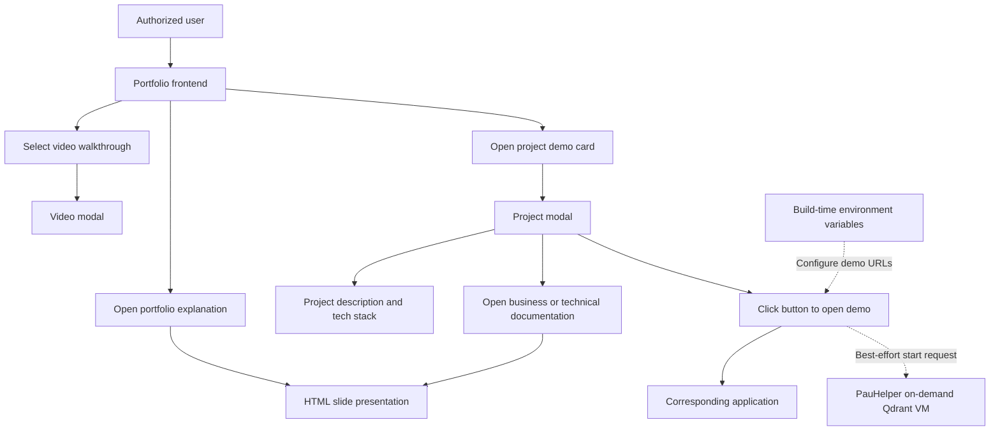
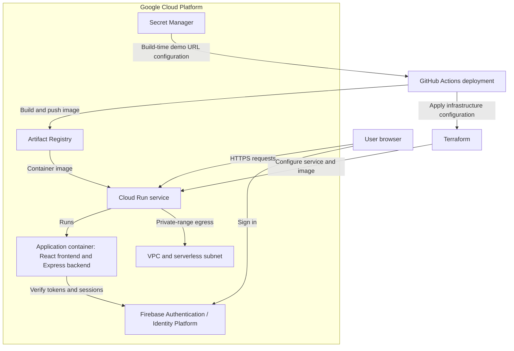
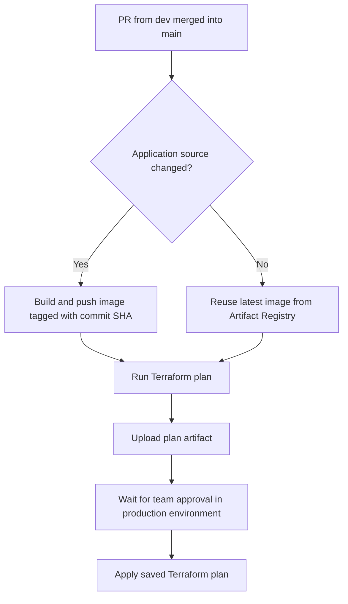

# Personal Portfolio app

Application to serve as the gateway to my personal portfolio projects.

## Description

This repository contains a web application designed to serve as the gateway to my personal portfolio in a secure, visually attractive, and cost-effective way. It provides information about my projects, demo videos, and access to my demo project applications hosted on Google Cloud Platform (GCP). Access is secured through Firebase Authentication and managed through my user pool.

Feel free to use it!


## 1. Business overview, use case, and value

In today's technology and AI development landscape, individuals and businesses share a common challenge: demonstrating their skills to potential clients, contractors, and hiring teams. A list of past work is not enough; real use cases help show how that knowledge translates into working solutions.

I created this project as a secure, time-efficient, and cost-effective gateway to my portfolio demos. It presents my skills and projects in a simple way through explanations, demo videos, and access to working applications.

The business value is straightforward: showcase my work while keeping access to the demos under my control. Only the people I authorize can use them, rather than making LLM access available to everyone.

The application starts with a basic, low-cost foundation designed to scale and support more features as my portfolio grows.

## 2. Repo structure

The repository has three main modules:

- **`frontend/`**: The React web application that presents my portfolio projects.
- **`infra/`**: The infrastructure module for Terraform files and deployment configuration.
- **`server/`**: The backend that handles application authentication.

The `auth-portal/` directory contains the HTML for the authentication portal served by the application. The `.github/workflows/` directory contains the GitHub Actions workflows. The `Dockerfile` and this README are located at the repository root.

```text
PersonalPortfolioRepo/
├── .github/
│   └── workflows/           # GitHub Actions workflows
├── auth-portal/
│   └── index.html           # Authentication portal HTML
├── frontend/                # React web application
│   ├── public/              # Static assets
│   └── src/                 # Application source and tests
├── infra/                   # Infrastructure module for Terraform
├── server/                  # Authentication backend
│   ├── app.js
│   ├── index.js
│   └── test/
├── Dockerfile               # Container image definition
├── nginx.conf.template      # Nginx configuration template
└── README.md
```

## 3. Tech stack

The application combines a lightweight frontend with an authentication backend and cloud-managed infrastructure:

- **Frontend**: React and Vite provide the user interface, Tailwind CSS handles styling, and Reveal.js powers the HTML slide presentations.
- **Backend and authentication**: Node.js and Express serve the application. Firebase Authentication, managed through Google Cloud Identity Platform, handles user sign-in, while the Firebase Admin SDK verifies authentication tokens and session cookies.
- **Cloud infrastructure**: The application runs on Google Cloud Platform (GCP), with Docker packaging the frontend and backend into a container image.
- **Infrastructure and automation**: Terraform manages the cloud resources, and GitHub Actions workflows automate deployment.

## 4. Frontend

The frontend provides a simple interface for exploring my portfolio. Users can open an explanatory slide presentation about the portfolio, watch project video walkthroughs, or browse project demo cards.

Opening a demo card displays a modal with the project description, its technology stack, and a button to open the corresponding application. Demo URLs are configured through environment variables at build time. For the PauHelper demo, clicking the button also sends a best-effort request to start its on-demand Qdrant VM; the demo opens without waiting for the VM.

HTML slide presentations provide detailed business and technical explanations about the portfolio and its projects.



## 5. Authorization

Access is restricted to users whose accounts I manually provision through Firebase Authentication. Public self-registration is disabled, so I control who receives credentials and can access the portfolio.

The current implementation uses administrator-provided email/password accounts, not federated sign-in or one-time passwords (OTPs). After sign-in, the backend verifies the Firebase token and creates a secure, HTTP-only session cookie. Protected requests check the session for revoked credentials or disabled accounts.

This lightweight setup is designed for a single administrator managing the infrastructure. It lets me grant access to selected people and revoke it when needed by disabling their accounts or revoking their sessions.

## 6. Cloud infrastructure

The application infrastructure is hosted on Google Cloud Platform (GCP). Its main component is a Cloud Run service that runs the application container, serving both the React frontend and the authentication backend.

The supporting services are:

- **Artifact Registry**: Stores the Docker images built and pushed by the deployment workflow. Cloud Run runs the selected image.
- **Firebase Authentication / Identity Platform**: Manages user accounts and authentication.
- **Secret Manager**: Stores configuration values with access controlled through IAM. The deployment workflow retrieves the demo URLs and passes them to the frontend build as environment variables. These URLs become part of the browser bundle, so they are not confidential once deployed.
- **VPC and serverless subnet**: Provide Cloud Run with Direct VPC egress for traffic to private network addresses.

Terraform manages the application infrastructure, while GitHub Actions automates image builds, publishing, and deployment.



## 7. Infrastructure as code and versioning

Terraform manages the application's cloud infrastructure. When a pull request from `dev` is merged into `main`, the GitHub Actions deployment workflow runs in two stages:

1. **Build and plan**: If application source files changed, the workflow builds and pushes a Docker image tagged with the commit SHA. It then runs `terraform plan` and uploads the plan as an artifact. If application files did not change, it reuses the latest image in Artifact Registry.
2. **Approval and apply**: The workflow uses GitHub's protected `production` environment for the apply job. After the required team approval, it applies the saved Terraform plan.

Tagging images with the commit SHA ties each deployed application image to the source revision used to build it.

