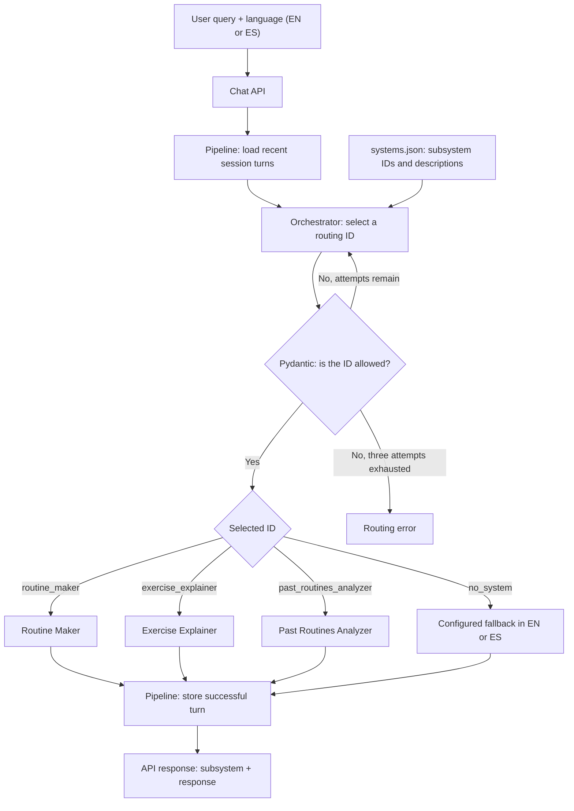
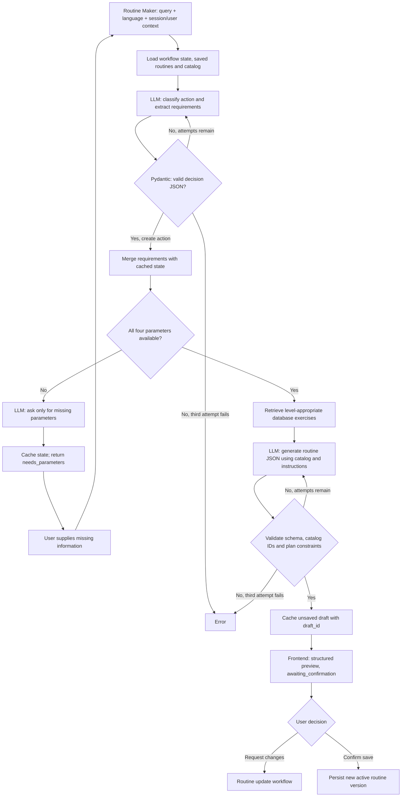
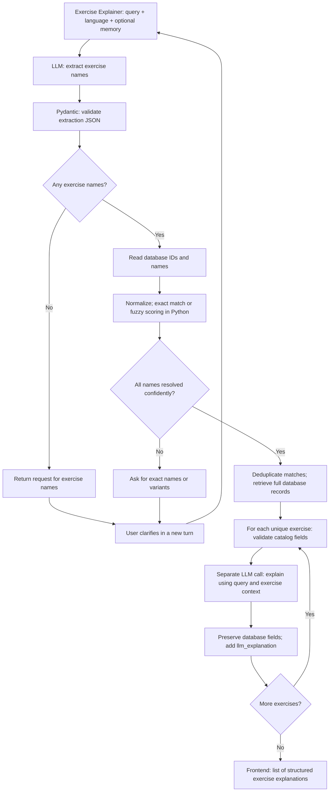
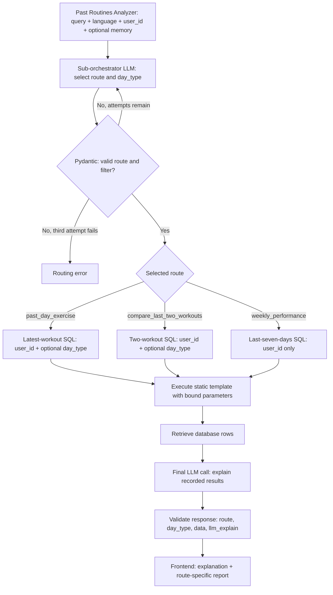
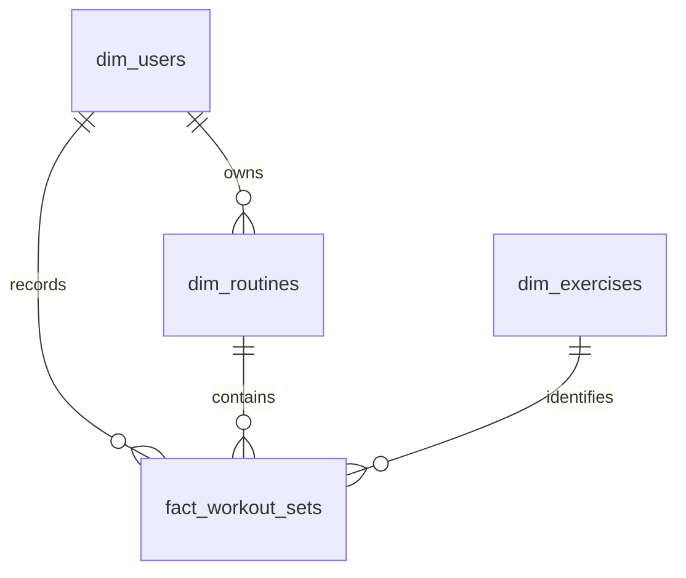
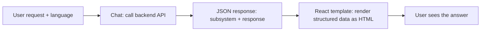
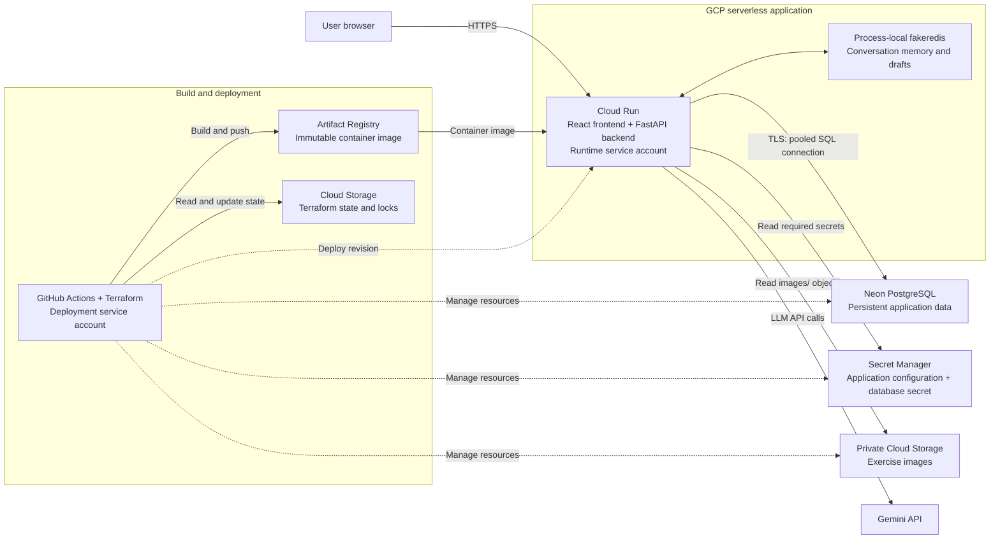
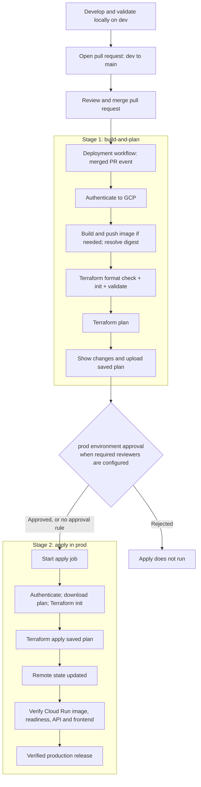

# Orchestrator App Repo

An agentic AI system connected to a SQL database that demonstrates how modern AI applications work and how natural-language queries can be routed to different integrated AI systems based on user intent.

## 1. Overview

Modern general-purpose AI chat applications, such as ChatGPT, Gemini, and Claude, can bring multiple AI capabilities and systems together in a single conversational interface. A key part of this experience is routing each user's request to the appropriate system based on their intent.

In this project, we call the component responsible for that routing the **orchestrator**. Using a list of available AI systems and capabilities, the orchestrator relies on a large language model (LLM) to decide where to send each query.

Although orchestration can become complex, this project presents a simple architecture and design, showing how an orchestrator can be integrated into an application for a realistic use case.

The project also includes:

- **A React frontend** with a chat interface and a button that lets users inspect what happens behind the scenes to understand how the system works.
- **A Terraform module** for provisioning the proposed Google Cloud Platform (GCP) infrastructure, including a virtual machine, databases, and secrets.
- **A deployment workflow** designed for a production environment, with pull request checks for changes coming from a development branch. To reduce costs for demonstration purposes, development runs locally rather than in a separate cloud environment.

Feel free to clone this repository and use it as a starting point for your own project.

## 2. Business Overview, Use Case, and Value

The selected use case is **Form**, a gym application. Fitness is a familiar topic for many people, making the example easy to understand and its underlying patterns easy to apply to other business needs.

Form lets users interact with a virtual fitness trainer through a chatbot and record their workout progress. The chatbot supports three tasks:

1. **Explain an exercise**, using exercise information and reference images.
2. **Create a workout routine**.
3. **Show the user's progress**, helping them review past workouts.

These tasks address common needs for gym users: planning routines, following them during training, reviewing previous workouts to support progressive overload, and clarifying how to perform exercises. And yes, this use case was inspired by being a gym rat.

### How the Use Case Works

The application combines an orchestrator, a SQL database storing users, routines, exercises, and workout records, and an image repository containing exercise illustrations.

The orchestrator identifies which of the three supported tasks matches the user's intent and routes the request to the appropriate specialized agent. That agent carries out the task under strict instructions, with observability measures and controlled database access. Rather than generating arbitrary SQL, agents supply parameters to predefined SELECT queries to retrieve the information they need.

Users can also access their saved routines directly in the **Routines** tab. The application uses the information stored in the database to present routines and workout records through a structured interface, not just through chat.

### Business Value

Although Form focuses on fitness, the same approach can be applied to many business scenarios:

- **Focused AI assistance:** support a defined set of business tasks rather than an unrestricted chatbot.
- **Intent-based routing:** direct each request to the agent or system responsible for that task.
- **Controlled data retrieval:** retrieve database information through predefined, parameterized queries, reducing the risk of incorrect queries.
- **Structured data presentation:** make stored information available through a clear application interface as well as conversational responses.
- **Access to unstructured resources:** retrieve supporting assets, such as images, from repositories outside the relational database.
- **Extensibility and observability:** incorporate additional AI systems over time while maintaining strict observability across routing decisions and task execution.
- **Infrastructure as Code (IaC):** define infrastructure in version-controlled code to support collaboration and repeatable deployments across environments.

## 3. Dependencies, Installation, and Local Execution

### 3.1 Prerequisites

Install the following tools before starting:

| Dependency | Use |
|------------|-----|
| **Git** | Clone the repository and manage source changes. |
| **Node.js 22.12+ on the Node 22 release line, with npm** | Install frontend dependencies and run Vite. The Docker build also uses Node 22. |
| **Python 3.12** | Recommended backend interpreter, matching the container image. The backend manifest supports Python 3.10+, while the separate root Python project requires 3.14+. |
| **uv** | Install the backend's locked dependencies and run Python commands in its virtual environment. |
| **Google AI Studio API key** | Authenticate live Gemini requests. Internet access and available API quota are required for agent responses. |

Docker is optional for local development; Terraform and the Google Cloud CLI are needed only for infrastructure/deployment work, not for the local SQLite setup. No separate Redis, PostgreSQL, or image-storage service is required locally.

Install Node.js, Git, and Python using your platform's package manager or official installers. Install uv using the [official uv installation guide](https://docs.astral.sh/uv/getting-started/installation/). If Python 3.12 is not already available, uv can install it with `uv python install 3.12`.

### 3.2 Clone and Configure

```bash
git clone https://github.com/VicenteZambrano12/OrchestratorApp.git
cd OrchestratorApp
```

Create a `.env` file at the repository root, using [.env.example](.env.example) as a reference. If a `.env` already exists, update it rather than overwriting it. The example contains placeholder alternatives such as `LOCAL/CLOUD`; replace them with actual values. A local configuration is:

```dotenv
MODE=LOCAL
SQL_DATABASE_TYPE=sqlite
SQLITE_DATABASE_PATH=database/gym_app.db
LLM_MODEL=gemini-2.5-flash-lite
GEMINI_API_KEY=your_google_ai_studio_api_key
```

Replace the API-key placeholder with your own key and never commit credentials. Use a Gemini model available to your account. Omitting `LLM_MODEL` uses the backend's default, but explicitly setting it to an empty value is invalid.

| Setting | Local behavior |
|---------|----------------|
| `MODE=LOCAL` | Serve images from the repository and use the local database configuration. |
| `SQL_DATABASE_TYPE=sqlite` | Select SQLite. The other supported provider value is `postgresql`, not `neon`. |
| `SQLITE_DATABASE_PATH` | Path to an existing SQLite file, relative to the repository root or absolute. |
| `GEMINI_API_KEY`, `LLM_MODEL` | Credentials and model used by the agent subsystems. |
| `VITE_API_BASE_URL` | Optional frontend setting; defaults to `/api`. Keep that default for the Vite proxy described below. Vite settings can be placed in a frontend-local environment file. |
| `LOG_LEVEL` | Optional backend process environment variable; defaults to `INFO`. Use `DEBUG` for operation timing. |

Process environment variables take precedence over the root dotenv settings. `GCS_IMAGES_BUCKET` and a TLS-enabled PostgreSQL `DATABASE_URL` are cloud settings and are not required in local mode. `APP_SECRETS_FILE` is an optional JSON configuration source for the combined server; it is not needed for the two-server local setup.

### 3.3 Install Dependencies

From the repository root:

```bash
cd backend
uv sync --locked --python 3.12
cd ../frontend
npm ci
cd ..
```

The backend command creates its virtual environment from the backend lockfile. `npm ci` installs the frontend versions recorded in its lockfile. Use the **backend project**, not the separate root Python package, for API development.

### 3.4 Run the Backend and Frontend

Start the API in one terminal, beginning at the repository root:

```bash
cd backend
uv run --python 3.12 uvicorn app:app --app-dir src --reload --host 127.0.0.1 --port 8000
```

This starts FastAPI with automatic reload during development. Check `http://127.0.0.1:8000/health` for `{"status":"ok"}` and open `http://127.0.0.1:8000/docs` for interactive API documentation. Health does not validate your Gemini key or database connection.

In a second terminal, also beginning at the repository root:

```bash
cd frontend
npm run dev -- --host 127.0.0.1
```

Open the Vite URL printed in the terminal, normally `http://127.0.0.1:5173`. Its development proxy forwards `/api` requests to port 8000 and removes the `/api` prefix, keeping browser requests on the frontend origin. If you change the API port, update the proxy target in [vite.config.js](frontend/vite.config.js).

To serve a built frontend and API together instead of using Vite:

```bash
# From the repository root
cd frontend
npm run build
cd ../backend
PYTHONPATH=src uv run --python 3.12 python -m server
```

The combined server defaults to port **8080**, serving the frontend at `/` and the backend at `/api`; API documentation is therefore at `/api/docs`. Set the process environment variable `PORT` to change its listening port. Keep `MODE=LOCAL` for local SQL and images.

### 3.5 Included Database and Images

The repository includes a populated [SQLite database](database/gym_app.db), its [schema reference](database/database_schema.json), and [exercise images](database/images). **Keep these assets in the checkout**: they make the local demo and tests that depend on bundled fixtures reproducible without cloud provisioning. No initial cloud migration is required to run locally.

Local writes, such as saving routines or workouts, modify the SQLite file. Back it up before experiments if you want to preserve the initial dataset; do not delete the database or images as a setup or cleanup step. Automated tests that create their own temporary databases should continue using those isolated fixtures.

## 4. Repository Structure

The application is organized into three main modules: **infra**, **backend**, and **frontend**. A supporting **database** directory includes a SQLite database and its schema, while **scripts** contains utilities for migrating database data and exercise images. The deployment workflow lives in **.github/workflows**.

The following tree highlights the main directories and files; individual source files and supporting assets are omitted for readability.

```text
OrchestratorApp/
|-- .github/
|   `-- workflows/
|       `-- terraform-deploy.yml     # Infrastructure and deployment workflow
|-- backend/
|   |-- src/                        # API, orchestration, and AI system implementation
|   |-- tests/                      # Backend tests
|   `-- pyproject.toml              # Backend dependencies and configuration
|-- frontend/
|   |-- public/                     # Public assets
|   |-- src/                        # React application
|   |-- tests/                      # Frontend browser tests
|   `-- package.json                # Frontend dependencies and commands
|-- infra/
|   |-- environments/
|   |   `-- prod/                   # Production Terraform configuration
|   |-- modules/
|   |   |-- artifact_registry/
|   |   |-- cloudrun/
|   |   |-- database/
|   |   |-- secrets/
|   |   `-- storage/
|   `-- scripts/                    # Infrastructure access bootstrap scripts
|-- database/
|   |-- database_schema.json        # Database schema reference
|   `-- gym_app.db                  # SQLite database
|-- scripts/
|   |-- migrate_database.py         # Database migration utility
|   |-- migrate_images.py           # Exercise image migration utility
|   `-- registry_images.py          # Exercise image registration utility
|-- src/
|   `-- orchestratorapp/            # Root Python package
|-- .env.example                    # Example environment configuration
|-- Dockerfile                      # Container image definition
|-- pyproject.toml                  # Root Python project configuration
|-- uv.lock                         # Root Python dependency lockfile
`-- README.md
```

## 5. Technology Stack Used

### 5.1 Backend

The backend uses **Python** and **FastAPI**. Rather than relying on an agent orchestration framework, it uses custom Python classes to make API calls, integrate agents, and coordinate task execution.

- **Pydantic** validates structured LLM outputs.
- **Google's Gemini API**, accessed through Google AI Studio, provides the models used by the AI systems.
- **uv** creates the virtual environment and manages Python dependencies.

### 5.2 Frontend

The frontend uses **React**, with **Vite** and its React plugin for development and builds, and **Tailwind CSS** for styling.

The **UI/UX Pro Max skill**, used with Claude, supported the interface design process to improve usability and the overall user experience.

### 5.3 Infrastructure

The infrastructure uses **Terraform** for Infrastructure as Code (IaC), **Docker** for containerization, and **GitHub Actions** for automated infrastructure and application deployment.

The deployment combines Google Cloud Platform (GCP) services with a Neon database:

- **Cloud Run** hosts a single container image containing both the frontend and backend.
- **Artifact Registry** stores the application's container images.
- **Neon PostgreSQL**, using a free subscription for this demo, provides the production SQL database.
- **Google Cloud Storage** provides a bucket for exercise images.
- **Secret Manager** stores application secrets and database connection credentials.

## 6. How the Agent System Works

When the frontend sends a user query and response language to `POST /{id}/chat`, the backend starts the agent pipeline. The session `id` provides conversation context; routine creation and history analysis also require a `user_id`.

The **orchestrator runs first** to identify the user's intent. It selects a subsystem, but does not execute it or answer the question itself. The **pipeline** then invokes only the selected subsystem and returns its response.



The selected subsystem receives the original query and requested language, along with the context it needs. For example, Routine Maker uses session/user-scoped draft state, while the exercise and history systems can use recent conversation turns. Successful turns are stored for subsequent follow-ups; the chat endpoint currently supplies the latest two turns to the pipeline.

The main entry points are the [chat endpoint](backend/src/api/Endpoint/chat.py) and the [Pipeline](backend/src/systems/pipeline/Pipeline.py). The default API response contains `subsystem` and `response`; clients can also request an NDJSON stream containing progress events and a terminal result or error.

### 6.1 First Step: The Orchestrator

The [Orchestrator](backend/src/systems/orch/Orchestrator.py) receives the user query and uses [systems.json](backend/src/config/systems.json) as its default catalog of available systems. The configuration contains:

- **A language map:** `ES` means Spanish and `EN` means English.
- **Subsystem definitions:** each has an `id`, a name, and a description explaining when it should be selected.

The three configured subsystems are:

| Routing ID | Responsibility |
|------------|----------------|
| `routine_maker` | Create or modify workout routines and handle routine-workflow follow-ups and confirmations. |
| `exercise_explainer` | Explain exercise execution, technique, setup, and common mistakes. |
| `past_routines_analyzer` | Retrieve and analyze past routines, logged workouts, and training progress. |

The language map documents the supported languages; the routing code validates `EN` and `ES` explicitly. The LLM receives the selected language code, not the entire language map.

#### Instructions and LLM Context

The [orchestrator prompt](backend/src/config/prompts/orchestrator/orchestrator.yaml) supplies the routing instructions as a separate system message. The user message contains a JSON payload with the original `query`, the configured `subsystems`, the requested `language`, and recent conversation `memory` when available.

The instructions tell the LLM to compare the query's intent with the subsystem descriptions and return **exactly one plain-text routing ID**. It must not answer the query, invoke a subsystem, return JSON, or add an explanation. For an unsupported request, it must return the reserved ID `no_system`.

#### Validation, Retries, and Fallback

The [Pydantic routing model](backend/src/utils/orch/dataclass/models.py) validates the returned value as a strict string belonging to the configured subsystem IDs or `no_system`. Extra text, an invented ID, or any other invalid selection is rejected.

The [routing helper](backend/src/utils/orch/func/route.py) logs rejected selections and repeats the LLM consultation with the same routing context, allowing **three attempts in total**. If all three fail validation, it raises an error rather than silently selecting a subsystem. Provider or configuration failures also propagate as errors; they are not converted into a no-match response.

A valid `no_system` selection is different from a routing failure. In that case, the pipeline returns a predefined message from the [fallback configuration](backend/src/config/prompts/nosystem/nosystem.yaml) in the requested language, without another LLM call. The message explains that the application supports routine creation, exercise explanations, and past-routine analysis.

### 6.2 Routine Maker

When the orchestrator selects `routine_maker`, the subsystem loads the user's session-scoped workflow state, saved routines, and exercise catalog. It uses separate LLM stages to identify the requested action, collect missing information, and generate or update a routine. The following flow focuses on **creating a new routine**.

#### Collecting and Validating Requirements

The first LLM call classifies the turn and extracts the requirements explicitly supplied by the user. Its JSON response includes the action (`create`, `update_saved`, `update_draft`, `save`, or `no_match`), extracted parameters, and any requested exercise changes.

For routine creation, the required parameters are:

| Parameter | Accepted values | Purpose |
|-----------|-----------------|---------|
| `routine_type` | `weider` or `ppl` | Select the workout split: Weider or push/pull/legs. |
| `days_per_week` | Integer from 1 to 7 | Define the number of training days. |
| `hours_per_session` | Positive number, at most 24 | Limit the available time per session; user-supplied minutes are converted to hours. |
| `level` | `beginner`, `intermediate`, or `advanced` | Adapt the routine and filter eligible exercises. |

The backend validates the JSON with Pydantic **before checking whether requirements are complete**. Invalid structured output is retried with validation feedback, for **three attempts in total**. Valid requirements are merged into the cached workflow so users can provide them across multiple turns; missing values are not replaced with invented defaults.

If any required parameter is still absent, routine generation pauses. A separate LLM call asks only for the missing information in the requested language, and the backend returns `status: needs_parameters`. The next user reply resumes the workflow using the stored requirements.

#### Generating and Validating the Routine

Once all requirements are available, the backend retrieves exercises from the database at or below the user's experience level. The generation LLM receives this catalog, the collected parameters, accumulated user requests, the routine JSON schema, and the [Routine Maker instructions](backend/src/config/prompts/routinemaker/routinemaker.yaml).

These instructions require the model to respect the selected split, training frequency, session time, user preferences, and safety guidance. **Only exercises from the supplied database catalog may be selected.** The generated JSON contains:

- **Routine:** `name`, `summary` explaining the plan, `days`, and `recovery` guidance.
- **Each training day:** `day`, `day_type`, `info` containing warm-up/focus guidance, `duration_minutes`, and `exercises`.
- **Each exercise:** `exercise_id`, `name`, `sets`, `reps`, `rest_seconds`, and `notes`. The backend fills exercise names from the catalog rather than trusting model-generated names. Time or distance targets can be represented in `reps`, with clarification in `notes`; generated plans do not prescribe weights.

The [Pydantic models](backend/src/utils/routinemaker/dataclass/models.py) validate the plan's structure and constraints, including the required number of consecutive training days, session duration limits, valid sets and rest intervals, catalog membership, and no duplicate exercise IDs within a day. Invalid plans receive validation feedback and are regenerated, again with **three attempts in total**. Exhausted validation retries raise an error; provider failures are not silently converted into a preview.

#### Returning the Preview

The validated routine is cached as an **unsaved draft** with a unique `draft_id`. The API sends the frontend a `routine_maker` response containing `status: awaiting_confirmation`, the collected `parameters`, a localized `message`, the structured `routine`, and the `draft_id`. The `routine_id` remains null until persistence succeeds.

The user can review the preview, request changes, or explicitly confirm saving. Generation alone does not save or activate a routine. Confirmation persists a new version and makes it the current routine; the direct save endpoint confirms the cached draft without another LLM call.



The stage coordination, retry loops, and confirmation handling are implemented in the [Routine Maker workflow](backend/src/utils/routinemaker/func/handle.py).

### 6.3 Exercise Explainer

When the orchestrator selects `exercise_explainer`, the subsystem identifies the requested exercises, resolves their names against the database, and generates an explanation for each matched exercise. It keeps **database facts separate from generated text**, so the LLM cannot replace stored instructions or image paths.

#### Extracting Exercise Names

The first LLM call extracts an `exercises` list from the user query. Recent conversation memory is included when available, allowing follow-ups such as "explain that again" to refer to previously discussed exercises. Spanish names are translated into English for catalog matching, while explicitly requested equipment and variants are preserved.

The extraction response is JSON with two fields: `exercises` and `message`. Pydantic validates this structure. If no exercise is named, the list is empty and `message` asks the user to supply a name or list of names in the requested language. The workflow returns that clarification instead of generating an explanation; it does not infer an exercise from a muscle group or equipment alone.

#### Matching Against the Database

The [exercise catalog resolver](backend/src/utils/exercise_explainer/func/catalog.py) reads exercise IDs and names from the SQL database. Matching happens **in Python**, rather than through a fuzzy SQL query:

1. Normalize names to ignore case, accents, and punctuation.
2. Prefer a unique exact match.
3. Otherwise, compare character similarity, token order, and shared tokens. A fuzzy match must score at least **0.78**, with a gap of at least **0.08** between the top two candidates.

If any name is unmatched or ambiguous, a deterministic decision branch stops the explanation stage and asks the user for the exact name or variant, offering up to three candidate names when available. It does not explain a guessed exercise or return only the resolved subset.

Once every name resolves, the backend retrieves the full records using parameterized queries. Duplicate matches are removed, preserving the requested order.

#### Generating Explanations and Returning Structured Data

For **each unique matched exercise**, a separate LLM call receives the original query, requested language, optional conversation memory, and that exercise's database record. The [explanation instructions](backend/src/config/prompts/exercise_explainer/exercise_explainer.yaml) ask it to address the user's question with purpose and main muscles, setup, execution steps, breathing, common mistakes, and safety guidance. Follow-up explanations can use simpler wording based on previous turns.

The API returns a list, even for a single exercise. Each item contains:

| Field | Source |
|-------|--------|
| `id`, `name` | Database identity and exercise name. |
| `description`, `instructions` | Stored exercise description and execution instructions. |
| `icon_url`, `anatomy_diagram_url` | Stored image locations, which may be null. |
| `media_urls` | Stored media paths, decoded from the database's `media_url` JSON field; either null or exactly two paths. |
| `llm_explanation` | The generated, exercise-specific explanation. |

Database content is preserved rather than rewritten by the LLM; only `llm_explanation` is generated. There is no separate muscular-group field in this response: muscle information can appear in the stored description, anatomy image, or generated explanation.

The [response model](backend/src/utils/exercise_explainer/dataclass/models.py) validates the catalog fields, and the workflow rejects blank explanations. Unlike Routine Maker, this subsystem has no three-attempt validation-repair loop: validation, provider, and database failures propagate as errors.



The extraction, clarification, and per-exercise generation stages are coordinated by the [Exercise Explainer workflow](backend/src/utils/exercise_explainer/func/handle.py).

### 6.4 Past Routines Analyzer

The `past_routines_analyzer` subsystem retrieves the user's **logged training data** and generates insights from those records. It uses an internal sub-orchestrator to select a retrieval strategy, executes a predefined SQL template, and makes a final LLM call to explain the results.

#### Selecting the Analysis Route

The sub-orchestrator receives the user query, requested language, available route descriptions, and recent conversation memory when available. Its LLM call returns JSON containing `route` and `day_type`, choosing one of three supported routes:

| Route | Retrieved data | Example request |
|-------|----------------|-----------------|
| `past_day_exercise` | Every recorded set from the latest matching workout. | "Show my last push day." |
| `compare_last_two_workouts` | Every recorded set from the two latest matching workouts. | "Compare my last two leg days." |
| `weekly_performance` | All logged workout sets from the last seven calendar days, including today. | "How was my training this week?" |

For the first two routes, the LLM also extracts an optional **training-day keyword**, such as `push`, `pull`, `leg`, or `full body`. This refers to the workout type, not a weekday or date. Spanish terms are translated into English, and the keyword is matched against stored routine names; for example, `push` matches "Push Day A (Chest/Triceps/Delts)".

If neither the query nor memory identifies a training day, `day_type` is null and retrieval is not filtered by day type. For `weekly_performance`, it must always be null. An unclear request defaults to the latest-workout route after considering memory.

The [Pydantic routing model](backend/src/utils/past_routines_analyzer/dataclass/models.py) restricts the route to the three supported IDs, normalizes the day keyword, rejects unsupported characters and extra fields, and enforces the weekly route's null filter. Invalid routing output is retried with the same context for **three attempts in total**. Exhausting those attempts raises an error rather than executing an arbitrary query.

#### Retrieving Training Records

The validated route selects a static query from the [SQL templates](backend/src/config/sql_templates/past_routines_analyzer). The backend **binds parameters rather than inserting generated SQL text**:

- Every query receives `user_id` to scope records to the requested user.
- Latest-workout and comparison queries also receive `day_type`, using a case-insensitive substring match against routine names when it is not null.
- The weekly query receives only `user_id`; its date window is defined by the template, not generated by the LLM. It covers today and the six preceding calendar days, rather than the previous Monday-to-Sunday week.

The returned rows include session identity and date, training-day name, exercise order and name, primary muscle, set number, repetitions, weight and unit, duration, distance, and RPE when recorded. Comparison rows additionally contain `training_rank`: **1** for the latest workout and **2** for the previous one.

#### Generating Insights and Displaying the Report

A final LLM call receives the original query, language, selected route, day filter, retrieved rows, and optional memory. The [explanation instructions](backend/src/config/prompts/past_routines_analyzer/explainer.yaml) require it to base every factual statement on those rows: summarize a session, compare recorded performance, or discuss weekly consistency, muscles trained, and volume.

Missing records are not invented. Empty results produce an explanation that no matching workouts were found; if only one session exists, the explanation must state that a two-session comparison is not yet possible. Blank or invalid explanations, provider failures, and database failures propagate as errors.

The API returns the selected `route`, `day_type`, unchanged database rows in `data`, and generated text in `llm_explain`. Pydantic validates this final envelope. **Only the explanation is model-generated; the structured training data is not reconstructed by the LLM.**

On the frontend, [PastRoutinesReport](frontend/src/components/PastRoutinesReport/PastRoutinesReport.jsx) displays the explanation and selects a predefined React view for the route: a past-workout report, workout comparison, or weekly-performance report. These views derive their statistics and visualizations from `data`, not from another LLM call or an LLM-generated UI template. An empty dataset receives an explicit no-history display.



The routing, SQL retrieval, and explanation stages are coordinated by [PastRoutinesWorkflow](backend/src/systems/past_routines_analyzer/PastRoutinesWorkflow.py).

### 6.5 Memory

The application uses **short-term, process-local memory** backed by **fakeredis**, an in-memory Redis-compatible store. Before routing a chat request, the pipeline retrieves the **latest two conversation turns** for the session and provides them in chronological order as context. If fewer than two turns exist, it uses the available history.

This context helps the orchestrator and relevant subsystems understand follow-ups, such as answering a missing routine requirement, confirming a preview, or asking for an exercise to be explained again. Successful turns are appended to the store for subsequent requests; the two-turn limit controls the context retrieved, not the total number of stored turns.

Conversation history is scoped by **`session_id`**. Routine Maker additionally stores its requirements, draft, and confirmation state under **both `session_id` and `user_id`**. The user ID also scopes database-backed routine and workout operations, but it is not an additional filter on conversation-turn retrieval.

The shared store is provided by the [memory dependencies](backend/src/api/redis_deps.py) and implemented by [RedisClient](backend/src/redis/RedisClient.py). It is not a persistent Redis service: memory is lost when the backend process restarts and is not shared across separate backend processes.

**Long-term conversational memory is not implemented.** Saved routines and workout records persist in the SQL database as application data, but they do not constitute a long-term conversation-memory system.

## 7. Databases and Image Storage

The application uses two complementary forms of persistent storage: a **structured SQL database** for application records and an **unstructured image repository** for exercise assets. The image repository is a filesystem or object store, not a second relational database. SQL records hold image paths that connect exercise metadata to those assets.

### 7.1 SQL Database

Local development uses the bundled [SQLite database](database/gym_app.db). Cloud deployment uses **PostgreSQL hosted by Neon**, allowing records to persist independently of Cloud Run instances.

Both providers use the same **logical schema**, including table names, relationships, and application fields. Their physical SQL definitions differ where necessary: for example, SQLite auto-incrementing integer IDs become PostgreSQL identity columns. The [schema reference](database/database_schema.json) documents the SQLite structure, while the [database migration utility](scripts/migrate_database.py) defines the PostgreSQL equivalents and copies local records into an empty target schema.

#### Database Schema

| Table | Responsibility | Main fields |
|-------|----------------|-------------|
| `dim_users` | Selectable user profiles and preferred weight units. | `id`, `username`, `weight_unit`, `created_at`. |
| `dim_exercises` | Authoritative exercise catalog, instructions, filtering attributes, and asset references. | `id`, `name`, `description`, `instructions`, `primary_muscle`, `secondary_muscles`, `pattern`, `equipment`, `level`, `tracking_type`, `media_url`, `icon_url`, `anatomy_diagram_url`. |
| `dim_routines` | User-owned routine versions and active-plan selection. | `id`, `user_id`, `name`, `description`, `is_active`, `updated_at`, `created_at`. Modern routine content and associated metadata are serialized in `description`. |
| `fact_workout_sets` | Individual exercise sets, linked to their user, routine, and exercise. | `id`, `user_id`, `routine_id`, `exercise_id`, `training_id`, `exercise_order`, `set_number`, `reps`, `weight`, `duration_seconds`, `distance_meters`, `rpe`, `created_at`. |

Each user can own multiple routines and logged sets. Each set references one routine and one catalog exercise; `training_id` groups performed sets into a workout session. Legacy template sets have a null `training_id` and are excluded from logged-workout analysis.



#### Shared SQL Client

Repositories and history-retrieval tools use [SQLClient](backend/src/sql/SQLClient.py) as the common database boundary:

- **Provider selection:** local mode defaults to SQLite and uses `SQLITE_DATABASE_PATH`; cloud mode selects PostgreSQL and requires a `DATABASE_URL` with credentials, a database name, and `sslmode=require` or stronger.
- **Bound parameters:** callers use positional `?` or named `:parameter` placeholders. The client translates these to psycopg's PostgreSQL syntax without interpolating user values into SQL.
- **Transactions:** context-managed operations commit on success, roll back on failure, and close the connection. SQLite connections enable foreign-key enforcement.
- **Explicit failures:** invalid configuration and connection/query errors propagate rather than silently switching providers or returning invented records.
- **Controlled retrieval:** agent workflows use predefined queries and allowlisted history templates. Provider-specific templates handle SQL-dialect differences where needed.

The migration utility is separate from Terraform provisioning: creating a Neon database does not by itself populate it with the local schema and exercise catalog.

### 7.2 Exercise Image Repository

Exercise images are stored outside SQL:

| Environment | Storage | Retrieval |
|-------------|---------|-----------|
| Local | The tracked [database/images directory](database/images). | FastAPI serves local files through the image mount. |
| Cloud | A private Google Cloud Storage bucket selected by `GCS_IMAGES_BUCKET`. | The backend reads objects beneath `images/` using its runtime service account and serves them to the browser. |

The `dim_exercises` fields `icon_url`, `anatomy_diagram_url`, and `media_url` store references rather than image bytes. The explanation workflow preserves these references; it decodes the stored media JSON into the response's `media_urls` list without asking the LLM to generate asset paths.

The [image-storage adapter](backend/src/api/image_files.py) selects local files or Cloud Storage according to `MODE`. Both are exposed through `/database/images` on the standalone API, or `/api/database/images` through the combined server. The [image migration utility](scripts/migrate_images.py) uploads the local image tree to the cloud bucket independently of container builds.

Keep the bundled database and image files for local execution and fixture-dependent tests. In the cloud, neither SQL data nor image assets depend on the container filesystem. The fakeredis conversation/draft store described in section 6.5 is separate, short-term memory rather than either of these persistent stores.

## 8. FastAPI Backend

The backend exposes agent execution, session memory, user profiles, routines, and logged workouts through FastAPI. The following application endpoints are listed in their **registration order** in [app.py](backend/src/app.py), including declaration order within each router.

### 8.1 Endpoints

| # | Method | Path | Request body data class | Response data class | Success | Purpose |
|---|--------|------|-------------------------|---------------------|---------|---------|
| 1 | `GET` | `/health` | None | [HealthResponse](backend/src/api/DataClasses/HealthResponse.py) | 200 | Report application liveness without checking external dependencies. |
| 2 | `POST` | `/{id}/routine/save` | [SaveRoutineRequest](backend/src/api/DataClasses/pipeline/SaveRoutineRequest.py) | [ChatResponse](backend/src/api/DataClasses/pipeline/ChatResponse.py) | 200 | Confirm a cached routine draft without routing or LLM calls. |
| 3 | `POST` | `/{id}/chat` | [ChatRequest](backend/src/api/DataClasses/pipeline/ChatRequest.py) | [ChatResponse](backend/src/api/DataClasses/pipeline/ChatResponse.py) | 200 | Route the query and execute the selected agent subsystem. |
| 4 | `POST` | `/{id}/key` | None | [SetKeyResponse](backend/src/api/DataClasses/SetKeyResponse.py) | 200 | Initialize session memory, optionally resetting the session. |
| 5 | `GET` | `/users` | None | List of [UserResponse](backend/src/api/user_deps.py) | 200 | List profiles in ID order; initialize a default profile if the table is empty. |
| 6 | `GET` | `/users/{user_id}/routine` | None | [RoutinePlan or LegacyRoutinePlan](backend/src/utils/routinemaker/dataclass/models.py), or null | 200 | Retrieve the user's active routine. |
| 7 | `PUT` | `/users/{user_id}/routine` | [RoutinePlan](backend/src/utils/routinemaker/dataclass/models.py) | [RoutinePlan](backend/src/utils/routinemaker/dataclass/models.py) | 200 | Save a new active routine version, optionally confirming an exact cached preview. |
| 8 | `POST` | `/users` | [UserRegistration](backend/src/api/user_deps.py) | [UserResponse](backend/src/api/user_deps.py) | 201 | Create a selectable local profile. |
| 9 | `POST` | `/users/{user_id}/workouts` | [WorkoutRequest](backend/src/api/DataClasses/Workout.py) | [WorkoutResponse](backend/src/api/DataClasses/Workout.py) | 201 | Record completed workout sets atomically as a new training session. |
| 10 | `GET` | `/users/{user_id}/days` | None | List of [WorkoutDay](backend/src/api/DataClasses/Workout.py) | 200 | Return the trailing seven UTC dates, oldest first, with logged-workout flags. |

Here, `id` is the caller-supplied session identifier, while `user_id` is a positive database profile ID. These values provide context and data scope; **they are not authentication credentials**.

Additional request and response details:

- **Session initialization:** `POST /{id}/key` accepts the optional query parameter `reset` (default `false`). Setting it to `true` clears that session's conversation and routine drafts before initialization.
- **Chat transport:** `POST /{id}/chat` returns JSON by default. With `Accept: application/x-ndjson`, it returns progress and heartbeat events followed by a terminal result containing the chat response, or an in-band error.
- **Routine reads and writes:** GET and PUT return the saved routine's ID in the `X-Routine-Id` response header when a routine is present.
- **Preview confirmation through PUT:** optional query parameters `session_id` and `draft_id` must be supplied together. The submitted plan must match the cached preview. The `language` query parameter accepts `EN` or `ES` and defaults to `EN`. Without preview identifiers, PUT saves the supplied plan as a new version.

### 8.2 Data Classes

The API uses Pydantic models for request and response validation; the routine workflow result is a typed dataclass included in the chat response.

| Data class | Main fields and rules |
|------------|-----------------------|
| [HealthResponse](backend/src/api/DataClasses/HealthResponse.py) | `status`, fixed to `ok`. |
| [SetKeyResponse](backend/src/api/DataClasses/SetKeyResponse.py) | `id` and `created`, indicating whether the session creation timestamp was inserted. |
| [ChatRequest](backend/src/api/DataClasses/pipeline/ChatRequest.py) | Required nonblank `query` and `language` (`EN` or `ES`); optional positive `user_id`; `client_saves_routine` defaults to `false`. |
| [SaveRoutineRequest](backend/src/api/DataClasses/pipeline/SaveRoutineRequest.py) | Required positive `user_id`, nonblank `draft_id`, and `language` (`EN` or `ES`). |
| [ChatResponse](backend/src/api/DataClasses/pipeline/ChatResponse.py) | `subsystem` and `response`. The response can be text, a routine workflow result, a list of exercise explanations, or a past-routine analysis. |
| [UserRegistration](backend/src/api/user_deps.py) | `username`, trimmed to 1-80 characters; `weight_unit` is `kg` or `lbs`, defaulting to `kg`. |
| [UserResponse](backend/src/api/user_deps.py) | Registration fields plus the positive profile `id`. |
| [RoutinePlan](backend/src/utils/routinemaker/dataclass/models.py) | `name`, `summary`, `days`, and `recovery`; nested days and exercise prescriptions are described in section 6.2. The PUT body is the plan itself, not a wrapper. |
| [LegacyRoutinePlan](backend/src/utils/routinemaker/dataclass/models.py) | Read-only representation of older saved templates, identified by `storage_format: legacy`; unavailable duration and rest values remain null. |
| [RoutineMakerResult](backend/src/utils/routinemaker/dataclass/models.py) | `status`, `parameters`, `message`, `routine`, `routine_id`, and `draft_id`. |
| [ExerciseExplanation](backend/src/utils/exercise_explainer/dataclass/models.py) | Original catalog fields and a separate `llm_explanation`, as described in section 6.3. |
| [PastRoutinesAnalysis](backend/src/utils/past_routines_analyzer/dataclass/models.py) | `route`, `day_type`, database rows in `data`, and `llm_explain`, as described in section 6.4. |
| [WorkoutRequest](backend/src/api/DataClasses/Workout.py) | Positive `routine_id` and a nonempty `sets` list of completed exercise sets. |
| [WorkoutSet](backend/src/api/DataClasses/Workout.py) | Positive `exercise_id`; at least one of positive `reps`, `duration_seconds`, or `distance_meters`; optional nonnegative `weight` and `rpe` from 1 to 10. |
| [WorkoutResponse](backend/src/api/DataClasses/Workout.py) | `training_id`, `user_id`, `routine_id`, UTC `date` and `created_at`, and `sets_saved`. |
| [WorkoutDay](backend/src/api/DataClasses/Workout.py) | `date`, English `day_of_week`, and `has_routine`, which indicates a logged workout rather than an active routine template. |

### 8.3 Documentation, Images, and Errors

FastAPI also provides Swagger UI at `/docs`, ReDoc at `/redoc`, and the generated OpenAPI schema at `/openapi.json`. These include the detailed request and response schemas. Exercise image files are served through the `/database/images` mount rather than a Pydantic JSON endpoint.

Invalid request input normally returns **422**. Profile and routine operations can additionally return **404** for unknown users, **409** for duplicate usernames or unsupported stored routine formats, or **422** for rejected workout/preview data. Unhandled processing failures return **500**. For streaming chat, execution errors are reported inside the stream after HTTP 200 has started; initial request validation still returns HTTP 422.

## 9. Frontend

The React frontend provides two main views: **AI Chat** and **My Routine**. On startup, [App](frontend/src/App.jsx) calls `GET /health` while independently initializing the user session. A loading skeleton is shown until both prerequisites succeed.

If the health check fails, the application displays a backend-unavailable screen with a retry action. Session initialization failures have their own recovery screen. A successful health check confirms that the backend can respond; it does not guarantee that Gemini or the database is available.

Session initialization calls `GET /users`, selects the first returned profile, and initializes its conversation with `POST /{id}/key`. The frontend currently uses the profile ID converted to a string as the session ID. Once the backend responds and a profile is activated, [MainView](frontend/src/pages/MainView/MainView.jsx) renders the interactive workspace.

### 9.1 Chat View

When a user sends a message, the frontend calls `POST /{id}/chat` with the query, selected response language (`EN` or `ES`), current `user_id`, and `client_saves_routine: true`. It prevents overlapping chat mutations while the request is pending.

Live chat requests ask for **NDJSON streaming** so the interface can display execution progress before the final response arrives. The API utility also supports ordinary JSON responses. It validates and normalizes the returned data before rendering it.



For streamed requests, the JSON result arrives in the terminal NDJSON event; progress events update the interface while the request runs.

Rather than using one generic text layout for every answer, [SubsystemResponse](frontend/src/features/ai-chat/components/SubsystemResponse.jsx) selects predefined React components according to the response type:

| Response | Presentation |
|----------|--------------|
| Exercise explanations | Interactive exercise cards containing stored instructions, images/media, and the generated explanation. |
| Routine draft | Structured routine preview with training days, exercise prescriptions, and explicit save confirmation. |
| Saved routine | Confirmation showing the saved routine's name. |
| Past-routine analysis | Route-specific workout, comparison, or weekly report with the explanation and data-backed visualizations. |
| Clarification or general guidance | Text rendered through the shared Markdown component. |

For routine previews, the Save action calls `PUT /users/{user_id}/routine` with the plan and the `session_id`, `draft_id`, and `language` query parameters. Explicit chat confirmations that return `save_requested` use the same persistence flow. The frontend reports success only after the save succeeds; failed saves retain the draft for retry. Although a direct POST confirmation endpoint exists, this frontend uses the PUT-based flow.

### 9.2 Routines View

**My Routine** lets users follow their saved training plan, edit future targets, and record what they actually performed. Opening the view calls `GET /users/{user_id}/routine` and reads `X-Routine-Id` to retain the saved version's identity. A null result produces a no-saved-routine state; failed reads show an error and retry control instead of appearing to be an empty plan.

The main workflow in [RoutineView](frontend/src/components/RoutineView/RoutineView.jsx) is:

1. **Choose a training day.** Browse its exercises, sets, repetition targets, rest guidance, and notes. Exercise and coaching actions can prepare a follow-up prompt in AI Chat for the user to review and send.
2. **Edit the plan when needed.** Adjust exercise targets, add, replace, remove, or reorder exercises. Confirming an update sends the complete plan to `PUT /users/{user_id}/routine`, creating a new active version rather than overwriting workout history. Legacy plans can be used for workout logging, but structural editing is disabled.
3. **Start a workout.** The selected day is locked while the workout is active. A local elapsed timer and rest timer support the session; performed-set inputs remain separate from the routine's planned targets.
4. **Record actual performance.** Enter repetitions and weights and mark exercises as completed. Finishing opens a confirmation step for the performed sets.
5. **Save the workout.** The frontend sends `routine_id` and the completed sets to `POST /users/{user_id}/workouts`. It validates the receipt before ending the local session. If saving fails, the workout and its inputs remain available for retry.

Saving a **routine version** and saving a **completed workout** are distinct operations: PUT changes the active plan, while POST records training history used by subsequent progress analysis. Local workout timers and unsaved edits are not durable backend records.

### 9.3 Other Functionalities

- **Weekly activity:** the [TrainingPanel](frontend/src/components/TrainingPanel/TrainingPanel.jsx) calls `GET /users/{user_id}/days` to show the trailing seven UTC dates and mark days with logged workouts. This reflects completed training, not merely scheduled routine days.
- **Plan summary:** the training sidebar independently retrieves the active routine to show planned frequency and session duration. Routine and activity failures have separate loading, error, and retry states.
- **Profile selection and registration:** the [UserDialog](frontend/src/components/UserDialog/UserDialog.jsx) lists profiles with `GET /users` and creates new ones with `POST /users`, including the preferred weight unit (`kg` or `lbs`). Switching initializes the selected profile's session before remounting the workspace, clearing the previous user's local chat and workout state. These are selectable profiles, not password-protected accounts.
- **New conversation:** the New Chat action calls `POST /{id}/key?reset=true`. Only after the backend confirms the reset does the UI clear the transcript. The reset removes session conversation memory and cached routine drafts, not saved SQL routines or workouts.
- **Language and appearance:** language controls switch English/Spanish interface text and the language sent to the agents; theme controls change the application's appearance.
- **Workflow inspection:** the workflow monitor exposes executed stages, streamed SQL metadata when supplied, and API response snapshots so users can inspect the request flow. It displays execution information, not private model reasoning.
- **Help and recovery:** guidance dialogs explain the supported tasks. Request errors are surfaced with recovery actions; suggested prompts populate the composer rather than silently sending a new message.

## 10. Cloud Infrastructure

The cloud deployment combines **Google Cloud Platform (GCP)** services with **Neon PostgreSQL**. Terraform manages the application stack, while GitHub Actions builds the container image and applies infrastructure changes. The configuration prioritizes low idle costs for a demonstration application rather than production-grade session durability.

### 10.1 Application Hosting and Data

- **Cloud Run:** hosts the built React frontend and FastAPI backend together in one container, served from the same origin. It provides managed, serverless container execution and HTTPS access. The current configuration scales to zero when idle and limits the service to one instance, with 1 vCPU and 512 MiB of memory.
- **Artifact Registry:** stores the application container images published by the deployment workflow. Cloud Run is deployed with an immutable image digest so the revision uses the exact selected image.
- **Neon PostgreSQL:** stores profiles, saved routines, exercises, and logged workouts outside the ephemeral container. The demo uses Neon's free plan, low compute bounds, and a pooled connection requiring TLS.
- **Exercise-image bucket:** a private Cloud Storage bucket holds exercise assets. The runtime identity can read objects only beneath the `images/` prefix; the application serves the images through its image endpoint. The bucket itself is not public.
- **Terraform-state bucket:** a separate, pre-existing Cloud Storage bucket stores remote Terraform state and lock objects under an application-specific prefix. GitHub Actions uses this backend during plan and apply. The bucket is bootstrapped outside the application stack, and the application runtime does not need access to it.
- **Secret Manager:** holds runtime configuration and LLM credentials in an application JSON secret, mounted read-only into Cloud Run. It also holds a separate database-connection secret. Populated application-secret versions are supplied outside Terraform; credentials are not baked into the container image.

The infrastructure composition is defined in [the production Terraform root](infra/environments/prod/main.tf), with remote-state configuration in [backend.tf](infra/environments/prod/backend.tf).

The deployable artifact is built from the root [Dockerfile](Dockerfile) using a **multi-stage Docker build**:

1. **Frontend build:** a Node 22 stage runs `npm ci` and `npm run build`, producing the static React assets with `/api` as the API base path.
2. **Backend build:** a Python 3.12 stage uses uv to install locked backend dependencies without development dependencies.
3. **Runtime image:** a Python 3.12 image receives the backend environment, backend source, and built frontend. It runs as a non-root user and starts the combined server on port 8080.

From the repository root, the image can be built with:

```bash
docker build --platform linux/amd64 -t orchestratorapp:local .
```

This builds the **cloud-oriented image**, not the two-server development setup. It defaults to `MODE=CLOUD` and requires runtime cloud configuration and credentials to run its cloud-backed features. The bundled SQLite database and local images are not copied into this image; cloud persistence and image storage remain external. Secrets are supplied at runtime rather than included in the build.

### 10.2 Deployment and Access Control

The [GitHub Actions workflow](.github/workflows/terraform-deploy.yml) runs when a pull request from `dev` is merged into `main`. It authenticates to GCP through **Workload Identity Federation**, using the configured Terraform deployment service account rather than a long-lived service-account key.

When application sources change, the workflow builds and pushes a new image to Artifact Registry; otherwise, it can reuse an existing image. It then checks Terraform formatting, initializes the remote backend, validates the configuration, and creates a plan. A dependent apply job uses the `prod` GitHub environment and applies that saved plan. Finally, it verifies the Cloud Run revision, deployed image, backend health endpoint, and frontend.

Infrastructure management uses the deployment identity, while Cloud Run runs under a **separate runtime service account**. Resource-scoped grants and conditional IAM bindings follow least-privilege intent: the runtime can read the required secrets and exercise-image objects, but does not inherit the deployer's infrastructure-management or state-access permissions. Bootstrap scripts establish deployment access for the relevant resources.

Cloud Run is publicly invokable so browsers can access the application. This does not make the buckets or secrets public, and infrastructure IAM is not a replacement for application-level authentication and authorization.

**Networking clarification:** the current Terraform does not provision a VPC, subnet, VPC connector, or private database route. It also does not configure CloudFront, which is an AWS service. The application uses Cloud Run's managed ingress and external service connections; it should not be described as a private subnet deployment.

### 10.3 Demo Memory and Production Considerations

Short-term conversation memory and routine drafts use **fakeredis inside the Cloud Run process**, avoiding the cost of a separate Redis service for this demo. This memory disappears on shutdown, scale-to-zero, restart, or rollout. Limiting Cloud Run to one instance does not make it durable.

The memory layer uses a Redis-compatible interface, providing a starting point for an external Redis deployment. However, an external service, connection configuration, and production client wiring are **not currently provisioned**. A production deployment would need shared memory storage and appropriate network/access configuration before safely scaling across instances.

### 10.4 Infrastructure Diagram

Solid arrows show runtime or delivery dependencies; dashed arrows show deployment management. The state bucket belongs to the deployment workflow, not the application's runtime data path.



## 11. Infrastructure as Code (IaC) and Terraform

As a single-developer project, the application uses a simple delivery model: **two working branches, `dev` and `main`, and one deployed environment, production**. Development runs locally to avoid maintaining a second cloud environment. Terraform defines the cloud resources as version-controlled code in the [infrastructure directory](infra), with the deployed stack composed in [the production environment](infra/environments/prod).

Changes are developed on `dev` and proposed through a pull request into `main`. The [deployment workflow](.github/workflows/terraform-deploy.yml) starts its deployment jobs **after that pull request is merged**, not when it is opened. Closing an unmerged pull request, or merging from a branch other than `dev`, does not run these deployment jobs.

### 11.1 Stage One: Build and Plan

The `build-and-plan` job prepares the application image and infrastructure proposal:

1. Check out the merged revision and authenticate to GCP through Workload Identity Federation.
2. Detect application-source changes, build and push the container image when needed, or reuse an existing image. Resolve the selected image to an immutable digest.
3. Check Terraform formatting, run `terraform init`, and validate the configuration with `terraform validate`.
4. Run `terraform plan` against the shared remote state, including the selected application image.
5. Display the proposed changes in the workflow logs and upload the saved binary plan as a short-lived artifact.

Image construction uses **Docker Buildx** and the multi-stage [Dockerfile](Dockerfile), targeting `linux/amd64`. The workflow tags a new build with the source revision, pushes it to Artifact Registry, and resolves the published image to a `sha256` digest. That digest is passed to Terraform as `app_container_image`, linking the infrastructure plan to the exact container artifact. If application sources have not changed, the workflow can select an existing image instead of rebuilding it.

Docker packages both application layers into one deployable image; Terraform manages the Cloud Run service and its dependencies. These are complementary steps: Terraform does not compile the frontend or install Python dependencies itself.

The plan lets a reviewer inspect the intended resource changes before the apply stage. This job does **not** apply the Terraform plan, although it can already publish and prune container images in Artifact Registry.

### 11.2 Human Review and Production Approval

The dependent `apply` job targets the GitHub environment named **`prod`**. To enforce a manual review gate, that environment must have **required reviewers** configured in the repository's GitHub settings. An authorized reviewer or team can then inspect the plan and approve or reject the deployment.

The workflow's `environment: prod` declaration selects the environment; **it does not configure required reviewers by itself**. Without that protection rule, a successful plan can proceed to apply without manual approval. Pull-request review before merging and deployment approval before applying are separate controls.

### 11.3 Stage Two: Apply and Verify

Once the plan job succeeds and any configured environment approval is granted, the `apply` job:

1. Checks out the same revision and authenticates to GCP.
2. Downloads the saved plan and runs `terraform init` against the same remote backend.
3. Executes `terraform apply` using **that saved plan**, rather than generating a different proposal.
4. Verifies that Cloud Run's latest revision is ready and uses the expected container image, then checks the backend health endpoint and frontend.

Terraform updates the remote state as it applies changes. The workflow serializes production runs to avoid overlapping deployments. A successful verification completes the release; failures remain visible in GitHub Actions rather than being reported as a successful deployment.

